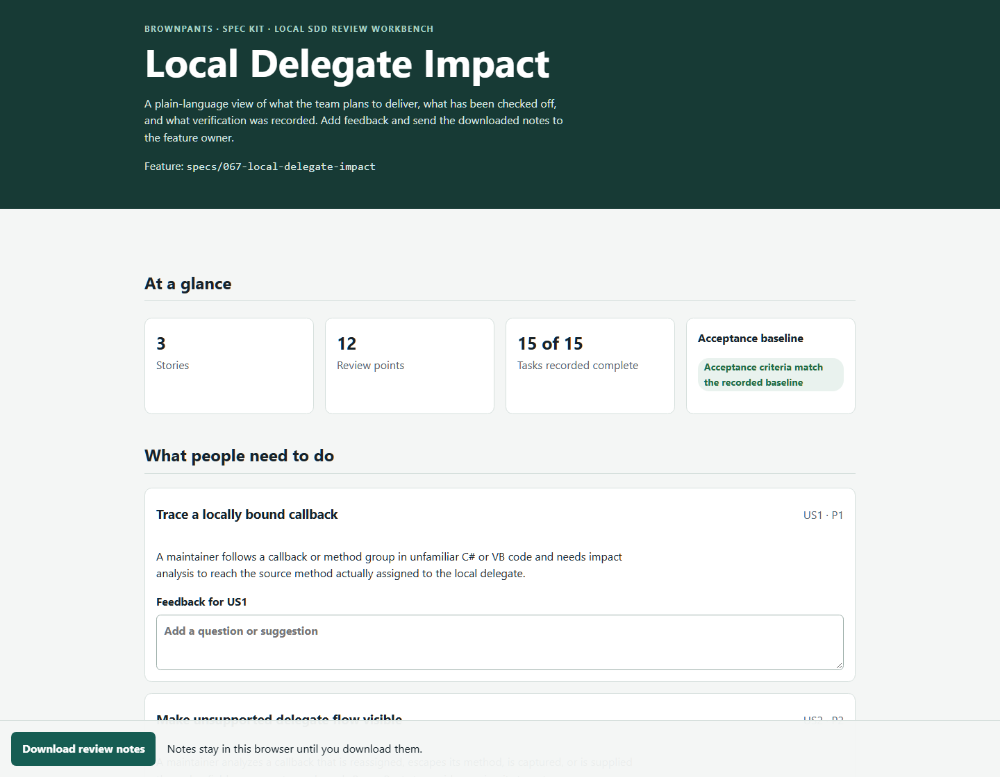
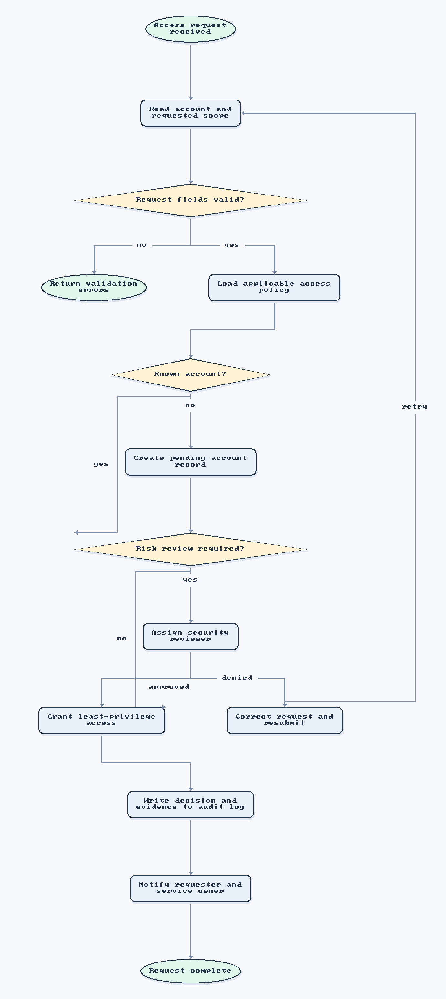
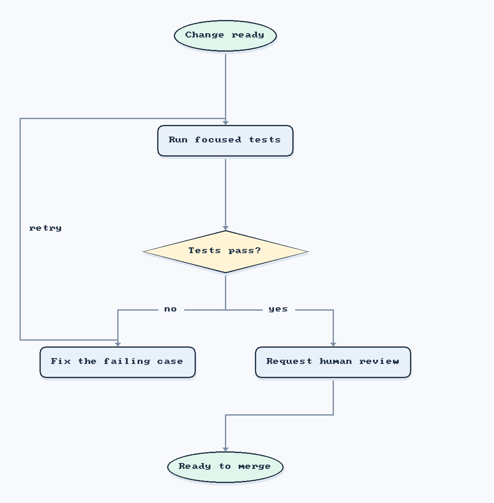

<div align="center">
  
  <h1>BrownPants</h1>
  <p><strong>Understand the system before you change it.</strong></p>
  <p>Local-first brownfield code intelligence for spec-driven development.</p>
  <p><a href="#brownfield-first">Explore brownfield analysis</a> · <a href="#measured-results">See measured results</a> · <a href="#quick-start">Quick start</a></p>
</div>

<p align="center">
  <a href="https://github.com/sidtrey/BrownPants/actions/workflows/ci.yml"></a>
  <a href="https://github.com/sidtrey/BrownPants/releases/latest"></a>
  <a href="LICENSE"></a>
</p>

> **Plain English:** BrownPants helps a team see what is already in an unfamiliar codebase, where changes may lead, and what was actually checked. Developers get evidence before they edit; QA gets a clearer handoff after the change. Core inspection runs locally without AI, builds, or source changes.

<p align="center">
  <a href="docs/screenshots/workbench-feature-review.png"></a>
</p>
<p align="center"><em>A real local workbench report. Reviewers can follow stories, acceptance criteria, tasks, and recorded verification, then download feedback without sending it over the network.</em></p>

> **Looks like someone has the Right idea.**

## Brownfield first

**Brownfield development** means changing a system that is already in use. It may have years of behavior, data, integrations, and user expectations that nobody has written down in one place. Those rules often live in source code, project settings, tests, and connections to other systems. **Greenfield** work starts with fewer of these existing obligations.

**Spec-driven development (SDD)** agrees on the problem, intended behavior, and checks before implementation. A spec describes the destination; brownfield work also needs a reliable picture of the starting point. Without it, a clear spec can still miss a caller, a compatibility promise, or a test that protects behavior people rely on. That is why repository context belongs in the work before the team finalizes its plan and acceptance criteria.

Think of renovating an occupied building: the plan describes the change, while a survey finds the wiring and load-bearing walls already there. BrownPants provides that survey for software. It gathers source-linked evidence for people and agents to check; the team decides what the product should do.

### How BrownPants fits into SDD

Imagine a request to change how an old order importer retries failed records. “Retry failed orders” states an intent, but not which importer path runs, who calls it, what retry state is stored, or which tests protect it. BrownPants helps the team investigate those questions before it commits to behavior and acceptance criteria.

1. **Map the repository.** `brownpants inspect <repo>` inventories languages, projects, and recognized patterns. This gives the team an initial map without building the software.
2. **Find relevant evidence.** `brownpants evidence <repo> --clue "order retry"` returns focused findings with file locations. After identifying a changed file, `brownpants impact <repo> --changed <path>` follows compiler-resolved managed callers and labels native or interop matches as candidates.
3. **Write the spec.** The team combines the user's need with evidence it has reviewed, then defines observable acceptance criteria and how each will be checked. BrownPants informs this decision; it does not decide the intended behavior.
4. **Plan and implement.** Spec Kit, OpenSpec, or another SDD workflow turns the spec into tasks and code. BrownPants integrations can refresh repository context, flag edits to hashed acceptance criteria for review, and connect tasks to recorded evidence.
5. **Verify and hand off.** Run the agreed checks, review affected paths, and give QA the criteria, evidence, and known analysis gaps. Candidate evidence does not prove runtime execution or test coverage.

BrownPants is built for existing systems: its .NET 10 host can inspect legacy .NET Framework 4.x C# and Visual Basic with Roslyn without building those projects. It also inventories C/C++, MFC, and C++/CLI markers and candidate evidence for factories, dependency injection, interop, and framework patterns. When compiler context is available, semantic mode resolves managed calls and explicit constructor use, including target-typed and generic construction. Findings state their evidence level and analysis limits.

In short, SDD records **what the team intends to change and how it will know the work is done**. BrownPants helps establish **what the existing system contains and what a change may affect**. It adds context to SDD tools without replacing their specs, plans, or human decisions.

## BrownPants in a day

- **You inherit a .NET Framework 4.x service with C# and MFC mixed together.** Run `brownpants inspect .` to see project markers, source coverage, and Roslyn structure without upgrading or building the old projects. Native C++ and MFC matches are labeled as candidate evidence; BrownPants does not claim it compiled or resolved native behavior.
- **A user reports a bug but does not know where it lives.** Run `brownpants investigate . --clue "timeout" --clue "ORD-42"` to find relevant source and test paths. After identifying changed C# or VB files, `brownpants impact . --changed <path>` follows resolved callers. For MFC/C++/CLI changes, it traces supported MFC dispatch and qualified native calls as separate lexical candidates. These leads help investigation; they do not claim root cause or test coverage.
- **An agent is about to implement a bug task.** Run `brownpants evidence examples/brownfield-bug-lab/managed --clue "OrderImportWorkflow" --changed Workflows/OrderImportWorkflow.cs --semantic` to give it findings selected by a literal clue and a changed source path. The JSON explains each selection and keeps candidates separate from resolved callers. Resolved findings include one-based source columns, so separate calls on the same line keep distinct IDs and remain navigable. `--semantic` loads MSBuild projects, so use it only when those project files are trusted. The full handoff remains available without selectors.
- **A team is using Spec Kit.** BrownPants supplies bounded repository context, checks the feature's hashed acceptance criteria, and maps tasks to observable evidence. The adapter refreshes context at workflow steps; maintainers still review any proposed criteria change.
- **QA needs to know what to verify and what shipped.** The local workbench presents feature scenarios and tasks. The Azure DevOps adapter can trace related work items, PRs, builds, and releases; the local PR preview carries QA guidance and evidence gaps. A user can prepare or create a draft PR, while review and merge stay human-controlled.
- **Your company restricts AI services or command-line agents.** BrownPants' default inspection runs locally without an LLM, network calls, project builds, or source modifications. IDE and SDD adapters are optional; an organization can use local reports or approved hosts without enabling online integrations.

## Measured results

### A repeatable win: tracing a delegate callback

In a frozen persistence-bug task, vanilla Codex found **1 of 2** expected managed-impact relationships in each of three runs. With BrownPants impact evidence, it found **2 of 2** each time. Recall rose from **50% to 100%**, precision stayed at **100%**, all three pairs favored the assisted run, and all six repairs passed the same independent check.

That result demonstrates a specific BrownPants strength: following a local method-group delegate to the code it calls. It applies to this fixture and recorded Codex setup; it is not a claim that BrownPants improves every task. See the [full protocol and results](docs/comparisons/delegate-impact-comparison.md), [scored data](docs/comparisons/delegate-impact-comparison.json), and [frozen inputs and run archive](examples/brownfield-bug-lab/evaluation/delegate-impact/).

### The broader brownfield task: evidence helped, advantage not proven

The [Brownfield Bug Lab](examples/brownfield-bug-lab/) is a small .NET 10 order importer with a seeded retry-row bug, generic overloads, factory/DI wiring, and analysis-only .NET Framework, MFC/C++/CLI, and NHibernate artifacts. It keeps the old integrations visible for inspection without requiring those frameworks to build.

It also demonstrates constructor impact across a generic factory and a DI registration. Run `brownpants impact examples/brownfield-bug-lab/managed --changed Workflows/OrderImportWorkflow.cs --format markdown --limit 1000` to see the factory's target-typed `new(repository)` resolved to `OrderImportWorkflow<Order>..ctor(OrderRepository<Order>)`, then traced through the registration and test caller paths. On the checked-in fixture this produces **4 direct callers, 1 transitive caller, 2 affected projects, and 1 test-path candidate**. Those counts describe the fixture's loaded source graph; they do not prove the DI container activates that factory at runtime.

BrownPants' own reports identify the legacy project and source candidates, including **21 architecture signals** with paths and lines. Its semantic impact report resolves the four managed calls around the changed batch save: single-item `Save(T)`, batch `Save(IEnumerable<T>)`, `SaveMapped<TSource>`, and the generic forwarding call from `SaveMapped` to the batch overload. The forwarding path matters because both ordinary and mapped imports can reach the affected method. MFC and NHibernate findings remain candidates; the fixture does not prove native-to-managed runtime behavior or database behavior.

The matched agent run produced the same narrow repair in both conditions, and the same independent regression check passed after each fix. On the frozen finding rubric, Spec Kit alone reached **25% recall and 71.4% precision**; Spec Kit plus BrownPants reached **30% recall and 66.7% precision**. That result **did not meet the advantage threshold**: it improved recall by five points while precision fell. The detailed report includes all scored findings, the exact task, source evidence, token counts, and limits. This negative result stays visible so the successful delegate result is not presented as universal.

Both pre-fix checks failed with “Batch import saved 1 of 2 orders.” The driver verified the frozen task hash and ran the same post-fix check in both copies; both passed. The [full protocol, scores, run details, and limits](docs/comparisons/brownfield-bug-lab-2026-10.md) include the machine-readable [results](docs/comparisons/brownfield-bug-lab-2026-10-results.json). This is a measured case study, not a general performance claim.

### Grouped evidence follow-up

The next matched run added deterministic `repeatedCandidateGroups` for repeated architecture/framework locations while preserving every raw finding. BrownPants grouped five sets in the fixture: C++/CLI bridge, MFC message map, and NHibernate session factory, session, and transaction. The [current head-to-head](docs/comparisons/brownfield-evidence-grouping-2026-10.md) scored **20/20 expected findings for both Spec Kit and Spec Kit + BrownPants** (100% recall, 86.96% precision each); both agents made the same fix. This run shows **no finding-quality advantage** for BrownPants on this prompt. The assisted run used **325,087 input / 5,010 output tokens**, while baseline used **704,193 input / 7,379 output tokens**; one pair does not establish cost or time savings. The [full results](docs/comparisons/brownfield-evidence-grouping-2026-10-results.json) include provider token details and a retained prompt-refinement pilot. Earlier v3 evidence-handoff results are preserved but superseded because their source commit and C++/CLI line could not be verified; see the [v4 report](docs/comparisons/brownfield-evidence-grouping-2026-10.md) for provenance limits.

BrownPants complements Spec Kit: Spec Kit structures the work; BrownPants adds evidence about the existing code and links completion claims to reviewable artifacts. Neither guarantees a correct fix or replaces human review.

A SHA-256 acceptance hash is a fingerprint of the agreed pass/fail conditions. If the criteria change during a task, the fingerprint changes and asks a maintainer to review the change. It keeps the goalposts visible; it does not prove the implementation is correct.

## Quick start

### Install the release

Download [`BrownPants.Cli.0.3.0.nupkg`](https://github.com/sidtrey/BrownPants/releases/download/v0.3.0/BrownPants.Cli.0.3.0.nupkg) from the GitHub release and place it in a folder such as `./release`. Then install the tool from that local package while NuGet restores its dependencies from your configured package feeds:

```powershell
dotnet tool install --global --add-source ./release BrownPants.Cli --version 0.3.0
brownpants inspect .
```

For restricted environments, configure an approved NuGet mirror as described below.

### Run from source

Requires the .NET 10 SDK.

```powershell
dotnet build BrownPants.sln
dotnet run --project src/BrownPants.Cli -- inspect .
dotnet run --project src/BrownPants.Cli -- inspect . --format json
dotnet run --project src/BrownPants.Cli -- inspect . --format json --limit 1000
dotnet run --project src/BrownPants.Cli -- inspect . --semantic
dotnet run --project src/BrownPants.Cli -- investigate . --clue "TimeoutException" --clue "ERR-42"
dotnet run --project src/BrownPants.Cli -- investigate . --clue "TimeoutException" --format json
dotnet run --project src/BrownPants.Cli -- impact . --changed src/OrderService.cs
dotnet run --project src/BrownPants.Cli -- workbench .
dotnet run --project src/BrownPants.Cli -- workbench . --engine openspec
dotnet run --project src/BrownPants.Cli -- instructions . --format markdown
dotnet run --project src/BrownPants.Cli -- instructions . --source .agents/custom-guidance.md --format json
dotnet run --project src/BrownPants.Cli -- instructions . --source AGENTS.md --section repository-guidelines --format markdown
dotnet run --project src/BrownPants.Cli -- placement --rule "All features follow this durable principle" --scope repository --durability enduring --purpose principle
dotnet run --project src/BrownPants.Cli -- models validate .
dotnet run --project src/BrownPants.Cli -- models report . --format markdown
dotnet pack src/BrownPants.Cli -c Release -o ./artifacts
dotnet tool install --tool-path ./.tools --add-source ./artifacts BrownPants.Cli --version 0.3.0
./.tools/brownpants inspect . # Windows: .\.tools\brownpants.exe inspect .
./scripts/test.ps1
```

### Use an approved NuGet mirror

The installed CLI's default `inspect`, `investigate`, and local workbench paths work without network access. Initial restore or tool installation still needs the pinned dependencies from a package source. If your environment blocks nuget.org, use your organization's NuGet configuration and trusted mirror:

```powershell
dotnet restore BrownPants.sln --configfile <approved-nuget.config> --locked-mode
dotnet build BrownPants.sln -c Release --no-restore
dotnet tool install --tool-path ./.tools --configfile <approved-nuget.config> --add-source ./artifacts BrownPants.Cli --version 0.3.0
```

Keep package-signature validation aligned with your organization's trust policy. Once installed, default repository inspection does not call the package source, an AI service, or a remote API.

`investigate` accepts one or more literal clues from a bug report, such as an error phrase, symbol, or path fragment. It returns deterministic path and line matches, labels likely test paths, and supports Markdown or versioned JSON output. Results are bounded and omit matched source text; binary files and files over 10 MiB are skipped for content matching. These matches are investigation leads, not evidence of root cause or regression coverage. The command is read-only and does not run code, tests, builds, or network requests. See the [investigation CLI contract](specs/017-bug-investigation-context/contracts/investigate-cli.md).

`instructions` maps common agent/project instruction files and any explicitly selected repository-relative files. It reports Markdown headings, approximate scope, byte counts, heuristic token estimates, and SHA-256 identities without exposing instruction contents. Use `--source <path> --section <anchor>` to return one canonical section, including its source and line range; the host still decides whether other instruction files are loaded, so retrieval does not guarantee token savings. See the [section retrieval contract](specs/024-lazy-load-context/contracts/instruction-section.md). To draft a frame, prepare JSON with a `budget`, ordered `points` with `text` and cited `sources` (`path` and optional heading `anchor`), and optional `reviewItems`, then run `dotnet run --project src/BrownPants.Cli -- frame create . ./frame-draft.json docs/agent-context-frame.md`. Use `frame validate . docs/agent-context-frame.md` to detect changed or missing sources. Output stays inside the repository and existing files are protected unless `--overwrite` is explicit. Review semantic summaries and conflicts yourself. Frames do not guarantee model memory or token savings; the host must load the frame instead of continuing to inject duplicate source files. See the [feature contract](specs/019-instruction-context-framing/contracts/instruction-context-frame.schema.json).

`models` validates a repository-local `.brownpants/models.json` policy, reports task-specific model preferences, and can export selected profiles for VS Code/Copilot, Visual Studio 18.4+, Claude Code, or Codex. VS Code and Visual Studio share `.github/agents/`, so generated filenames distinguish the two. Copy and edit the [example policy](examples/model-routing-policy.json) first. Exports preserve conflicts and require explicit host selection. Generated agents set a model only when the host or user invokes them; BrownPants does not schedule tasks, authenticate, check model access, or recommend current model products. See the [model-routing guide](docs/model-routing.md).

`placement` recommends whether a proposed rule belongs in a constitution, feature spec, or agent/contributor guidance. Supply explicit `--scope`, `--durability`, and `--purpose` values; `unknown` produces focused clarification questions, and `mixed` recommends a split. Repository-wide durable outcomes are split between a lasting principle and feature-specific outcomes. The command emits deterministic Markdown or JSON, explains its rubric, and never edits project artifacts or infers intent from keywords. See the [placement contract](specs/020-requirement-placement-guidance/contracts/placement-guidance.schema.json) and [quickstart](specs/020-requirement-placement-guidance/quickstart.md).

Spec Kit implementation guidance freezes the active feature's acceptance scenarios and success criteria in `acceptance-criteria.sha256`. Run `pwsh -NoProfile -File scripts/acceptance-criteria-hash.ps1 -SpecPath <feature>/spec.md` before implementation and completion. A changed digest requires review; `-Refresh` intentionally replaces the baseline and should only follow explicit agreement. Map every task to `AC-###` and `SC-###` IDs in a feature-local `acceptance-evidence.json`, then validate it with `pwsh -NoProfile -File scripts/check-acceptance-evidence.ps1 -RepositoryRoot . -SpecPath <feature>/spec.md -TasksPath <feature>/tasks.md -EvidencePath <feature>/acceptance-evidence.json`. This structural check never executes recorded commands and requires completed tasks to cite existing evidence files; humans still judge whether tests prove the behavior. A changed existing baseline requires a feature-local `acceptance-criteria-review.md` and the `acceptance-criteria-reviewed` pull request label after maintainer review. A first baseline for a new feature is exempt; a late first baseline for an existing feature needs review. CI checks the baseline, reruns its review policy when the label changes, and validates ledgers when their task list or ledger changes. Configure the CI job as a required pull request check to block merges when these policies fail. See [the acceptance integrity procedure](specs/021-acceptance-criteria-integrity/quickstart.md).

`inspect` reports project markers and grouped ecosystems, source-language coverage, file type counts, likely test paths, top-level entries, and supported SDD workflow artifacts when present. Spec Kit feature directories and OpenSpec capability/active-change directories are reported separately, with artifact paths bounded by `--limit`. When evidence is unambiguous, each workflow can also report an active work item: Spec Kit uses the validated `.specify/feature.json` pointer, OpenSpec selects only a single non-archived change directory, and custom workflows can declare an explicit path under their artifact roots. Multiple OpenSpec changes remain unselected, and invalid custom selections are diagnosed without discarding other workflow inventory. Ecosystem markers cover common .NET, C/C++, CMake/Make, Python, JavaScript/TypeScript, Go, Rust, JVM, Ruby, PHP, Apple, Dart, Elixir, Scala, container, and infrastructure files. Extensionless files and unfamiliar suffixes remain in file counts. The scanner skips common VCS, build, package, and environment directories and avoids following directory symlinks. Markdown is reviewable context for any planning workflow; JSON is available for tools and other SDD engines and starts with root `SchemaVersion: 1`. JSON consumers should check this integer before reading fields; it versions the report contract independently of the package. Optional additive fields remain version 1, while breaking field changes require a new schema version. Test-path signals remain heuristic, and project references are reported as written in project files rather than resolved into a dependency graph.

Language coverage identifies what BrownPants actually analyzes: Roslyn syntax and candidate patterns for C# and VB.NET, lexical candidate patterns for Python, JavaScript/TypeScript, Java/Kotlin, Go, and native C/C++, and inventory-only coverage for other recognized source languages. Go candidates include `NewType` constructor naming and Fx/Dig provider and invocation calls. Python candidates include factory class/method/call naming, Dependency Injector provider declarations, and dependency markers such as FastAPI `Depends`, `Provide[...]`, and `@inject`. JavaScript/TypeScript candidates include factory class/method/call naming, Angular `useFactory`/`inject`/`@Injectable` cues, and container `bind`/`get` calls. Java/Kotlin candidates include factory class/method/call naming and Spring, Jakarta Inject/CDI, Dagger, and Guice annotations such as `@Bean`, `@Provides`, `@Binds`, `@Inject`, and `@Autowired`, plus Guice binding and injector-creation calls. These lexical analyzers filter comments and quoted strings, but do not parse source syntax or resolve runtime dependency graphs. Ecosystem detection comes from conventional manifest names; it does not prove that every listed project is active or buildable.

Roslyn parses C# and Visual Basic files without building the project, so legacy .NET Framework source can be inspected from a .NET 10 host. Reports include `.csproj` and `.vbproj` target framework values, project references, type/member declarations, import/using directives (C#), invocation syntax, inactive preprocessor text (C#), and parser diagnostics. Where a C# project has one explicit `LangVersion`, that version is used for its source files. Default mode reports invocation syntax without binding calls to target methods; `--semantic` opts into that resolution. Default mode also leaves MSBuild conditions/imports and preprocessor symbols unevaluated, and parser diagnostics are not build results. By default, structured symbol samples are capped at 200; raise the cap for JSON with `--limit 1000` (maximum 10000).

C# and VB.NET factory-method name candidates omit `void`/`Sub` methods and string-returning helpers. Other return types remain naming-based candidates and should be checked at their cited source locations.

Pass `--semantic` to opt in to MSBuildWorkspace project loading. When the required MSBuild installation and references are available, BrownPants resolves C# and Visual Basic invocation expressions and object construction to method and constructor symbols. Constructor declarations include source-backed implicit constructors and C# primary constructors, anchored to their type declarations when no explicit constructor syntax exists. Reports include caller-to-target edges, in-repository declaration locations, separate method and constructor counts, unresolved candidate reasons, workspace issues, and compiler errors. Calls inside C#/VB lambdas and anonymous methods retain their named enclosing method and a source-relative callable anchor; local functions retain their parent callable identity. Compiler errors are summarized by project and diagnostic code with exact counts; bounded source-located samples remain available beside the groups. Group frequency is evidence for triage, not a root-cause diagnosis. Workspace diagnostics preserve the failure reason, show repository paths relative to the scan root, and replace external absolute paths with `[external-path]`. Closed generic targets retain their constructed signatures and match open generic declarations for impact tracing. One stable solution context is loaded; discovered projects outside it are opened directly, and duplicate project paths are analyzed once. Coverage is marked incomplete when a project cannot be loaded or workspace issues occur. This mode may evaluate project imports and run design-time builds; review the repository before using it. Results reflect MSBuild's loaded configuration, and unresolved relationships or compiler errors do not by themselves prove a runtime defect.

`impact` accepts changed C#, Visual Basic, and C/C++ source paths. Managed paths use Roslyn-resolved method and constructor relationships; native paths use bounded lexical MFC dispatch, qualified-call, and supported typed C++/CLI-to-managed declaration candidates, clearly separated in Markdown and JSON. Managed `inspect --semantic` keeps its public resolved-call sample bounded by `--limit`; impact traversal independently retains up to 100,000 resolved method and constructor edges. Reaching that internal ceiling is reported with retained and omitted counts and makes impact incomplete. Other limits, including sampled declarations, unresolved calls, and project-loading issues, remain visible. A changed managed repository method can now trace through its impacted callers into exact matching C++/CLI, native-call, and MFC candidates. For example, `brownpants impact examples/brownfield-bug-lab --changed managed/Persistence/OrderRepository.cs` follows `OrderImportWorkflow<T>.ImportBatch` to the bridge and MFC command map. JSON exposes both native `Depth` and the `ManagedImpactDepth` that led to the native trace; native depth retains its native-only meaning. A changed managed workflow also traces directly through its typed bridge call. Native and interop candidates do not prove compiler binding, overload selection, runtime dispatch, or execution. Candidate test paths do not prove coverage, and graph size is not an effort estimate. Native-only impact reads source without loading MSBuild projects; requests that include managed paths explicitly load managed projects through MSBuildWorkspace, which may evaluate project imports and design-time targets. See the [managed impact report contract](specs/023-call-impact-report/contracts/impact-report.md), [native impact contract](specs/055-native-call-impact/contracts/impact-report.md), [managed interop contract](specs/056-managed-interop-impact/contracts/interop-evidence.md), and [constructor impact contract](specs/050-semantic-constructor-impact/contracts/semantic-impact.md).

`workbench` creates a self-contained HTML review page. By default it uses the active Spec Kit feature; add `--engine openspec` to review the unique active OpenSpec change, or select one with `--feature openspec/changes/<name>`. Open the generated `TestResults/brownpants-workbench.html` in a browser to review the proposal, requirements/scenarios, task status, and design. Reviewers can attach notes and download a JSON handoff; this does not edit feature files or send data over the network. See the [Spec Kit quickstart](specs/035-sdd-workbench/quickstart.md), [OpenSpec quickstart](specs/036-openspec-workbench/quickstart.md), and [OpenSpec contract](specs/036-openspec-workbench/contracts/workbench-openspec.md).

`diagram` turns a repository-local description into a deterministic PNG and matching editable diagrams.net XML sidecar. Rendering is local, works without Mermaid or a hosted chart service, and makes no network requests. The `software` symbol profile distinguishes starts, work steps, decisions, input/output, and endings. Choose a top-down or left-to-right layout; paths, branches, loops, and separately labeled parallel connections are retained. Named or custom themes carry the same colors through PNGs, tiles, and editable XML without changing graph layout. See the [theme guide](docs/chart-themes.md) and runnable [Blue Water palette](docs/themes/blue-water.json). BrownPants prints a short plain-English explanation and states what the source does and does not prove.

````markdown
```brownpants-flow
flowchart brownfield-review
node start start "Legacy code"
node inspect process "Inspect"
node impact process "Trace impacts"
node criteria process "Set criteria"
node verify process "Verify"
node review end "Review"
edge start -> inspect
edge inspect -> impact
edge impact -> criteria
edge criteria -> verify
edge verify -> review
```
````

```powershell
dotnet run --project src/BrownPants.Cli -- diagram . docs/flows/access-review.md --output docs/flows/access-review.png
dotnet run --project src/BrownPants.Cli -- diagram . docs/flows/access-review.md --output docs/flows/access-review-wide.png --direction left-to-right
dotnet run --project src/BrownPants.Cli -- diagram . docs/flows/team-ownership.md --output docs/flows/team-ownership.png
dotnet run --project src/BrownPants.Cli -- diagram . docs/flows/bug-investigation-brainstorm.md --output docs/flows/bug-investigation-brainstorm.png
dotnet run --project src/BrownPants.Cli -- diagram . docs/flows/roslyn-call-resolution.md --output docs/flows/roslyn-call-resolution.png
dotnet run --project src/BrownPants.Cli -- diagram . docs/flows/access-review.drawio --input-format drawio --output TestResults/imported-access-review.png
dotnet run --project src/BrownPants.Cli -- diagram . docs/flows/access-review.md --output TestResults/access-review-blue.png --theme blue-water
dotnet run --project src/BrownPants.Cli -- diagram . docs/flows/access-review.md --output TestResults/access-review-custom.png --theme-file docs/themes/blue-water.json
```

Use `brownpants-flow` for a process map, `brownpants-org` for a one-manager-per-person hierarchy, or `brownpants-brainstorm` for a nested idea map. For example, an org chart starts with `organization support`, declares people with `person id "Role name"`, and connects them with `reports lead -> teammate`. A brainstorm starts with `brainstorm bug-review`, declares `idea id "Question or idea"`, then connects topics with `branch parent -> child`. Tree inputs with cycles, disconnected nodes, or multiple parents are rejected so BrownPants never guesses ownership or idea structure.

Keep visible node and edge labels short enough to scan. BrownPants wraps labels within reserved bounds, increases chart spacing for long edge labels, and rejects a label that cannot fit cleanly. Move longer explanations into optional `details "..."` text on a node or labeled edge; details stay in the editable XML tooltip and do not enlarge the PNG. Visible labels allow up to 80 characters; details allow up to 1,000. For example: `node store process "Save order" details "Write the mapped order and audit record through the legacy repository."`

Review every chart against four standards: **simple** (purpose and main flow are clear), **elegant** (consistent hierarchy, spacing, and restrained decoration), **usable** (labels and relationships are legible at the stated viewing scale), and **useful** (it answers the team's question and shows evidence gaps).

To review the chart examples with a team, use the [chart usability scorecard](docs/chart-review-scorecard.md). It records independent feedback at the documented viewing scale and states the acceptance thresholds; do not substitute implementer or AI scores for stakeholder review.

The example below shows a real review path, including validation, account and risk decisions, a denial-and-retry loop, and an audit record. Its companion [editable XML](docs/flows/access-review.drawio) is saved beside the image.

Here is the rendered chart generated from the example above with BrownPants' local renderer:



The [source Markdown](docs/flows/access-review.md) is checked in alongside the PNG. It shows a realistic review path, including a rejected request, a new account, a security review, and a correction loop. Regenerate it with the first command above; no remote renderer is involved.

For a compact example, this release-check chart is 1188 × 1208 pixels and was checked at native size. Its labels remain within non-overlapping shapes, and its editable source is available beside the [PNG](docs/flows/compact-release-check.png).



The larger [release pipeline source](docs/flows/tiled-release-pipeline.md) renders to four ordered 1800-pixel tiles with 128-pixel overlaps. The [tile manifest](docs/flows/tiled-release-pipeline/tiled-release-pipeline.tiles.json) records their order and bounds; open [tile 1](docs/flows/tiled-release-pipeline/tiled-release-pipeline-x0000000-y0000000.png), [tile 2](docs/flows/tiled-release-pipeline/tiled-release-pipeline-x0000000-y0001672.png), [tile 3](docs/flows/tiled-release-pipeline/tiled-release-pipeline-x0000000-y0003344.png), and [tile 4](docs/flows/tiled-release-pipeline/tiled-release-pipeline-x0000000-y0005016.png) in order. The router now checks short forward and return paths against the complete set of connectors; this example has no unrelated connector crossings, and all declared connections are preserved.

Regenerate the compact image with `dotnet run --project src/BrownPants.Cli -- diagram . docs/flows/compact-release-check.md --output docs/flows/compact-release-check.png`. Regenerate the tiled bundle with `dotnet run --project src/BrownPants.Cli -- diagram . docs/flows/tiled-release-pipeline.md --output docs/flows/tiled-release-pipeline.png --tile-size 1800 --overlap 128 --overwrite`.

BrownPants can also import a supported diagrams.net `.drawio` file with `--input-format drawio`, then render a local PNG and editable XML sidecar. The current compatibility profile covers one page, the default layer, standard process/decision/terminal/input-output/cloud shapes, bounded styles, labels/tooltips, integer node geometry, and edge waypoints. It rejects multiple pages, custom shapes, HTML labels, external resources, nested layers, and other unmodeled XML instead of silently dropping it. This is a tested interoperability profile, not a claim of full diagrams.net compatibility; see the [format contract](specs/068-polished-local-flowcharts/contracts/diagram-cli.md) and [synthetic corpus](tests/BrownPants.Tests/Fixtures/DrawioCompatibility/README.md).

Other charts make team structure, bug-investigation, and code-analysis questions easier to discuss:

| Request | Example | What the chart clarifies |
|---|---|---|
| “Who owns each group?” | [Team org chart](docs/flows/team-ownership.png) · [source](docs/flows/team-ownership.md) | Reporting paths from product owner to QA and development teams. |
| “How should we investigate this bug?” | [Brainstorm map](docs/flows/bug-investigation-brainstorm.png) · [source](docs/flows/bug-investigation-brainstorm.md) | Reproduction, call tracing, test impact, acceptance checks, and QA handoff. |
| “How does Roslyn decide where a C# call goes?” | [Call-resolution flow](docs/flows/roslyn-call-resolution.png) · [source](docs/flows/roslyn-call-resolution.md) | The current semantic-analysis path, from project compilation to resolved or explicitly unresolved call evidence. |
| “What calls our PNG renderer?” | [BrownPants caller chart](docs/flows/local-png-render-callers.png) · [editable source and rerun command](docs/flows/local-png-render-callers.md) | Five direct callers, including three test-path candidates; the chart states its depth and unresolved delegate targets. |
| “How does BrownPants keep an output path inside the repository?” | [BrownPants method behavior chart](docs/flows/brownpants-path-safety.png) · [editable XML and rerun command](docs/flows/brownpants-path-safety.md) | Roslyn's C# control-flow blocks show path validation, platform-specific comparison, return, and explicit error paths. |

This Roslyn chart documents the analyzer's source-level processing flow. BrownPants `inspect --semantic` loaded 12 projects in this repository and resolved 11,296 invocation targets in its latest self-inspection; those are static compiler bindings, not proof that calls execute at runtime. To chart callers for one exact C# or Visual Basic method, use `brownpants inspect <repository> --semantic --format markdown --limit 10000` to find its fully qualified symbol, then run `brownpants chart callers <repository> --source <relative.cs-or-vb-path> --method '<exact-symbol>' --semantic --output TestResults/callers.png --depth 8 --limit 1000`. This writes a local PNG and editable `.drawio` sidecar, labels test-path nodes as candidates, and shows when project loading or graph sampling left gaps. `--semantic` evaluates projects; imported MSBuild targets may execute.

To answer **“what does this method do?”**, use `brownpants chart flow` with the same exact C# or Visual Basic method symbol:

```powershell
brownpants chart flow <repository> --source <relative.cs-or-vb-path> --method '<exact-symbol>' --semantic --output TestResults/method-flow.png
```

BrownPants lays out Roslyn's compiler control-flow blocks, decision conditions, loop cycles, returns, and explicit throw/rethrow paths, with source lines and full block details in the editable XML. Implicit runtime exceptions are not represented by Roslyn's method CFG and are not claimed by the chart. Complex methods may need multiple tiles; use the manifest to follow them in order.

When a source parser cannot establish a diagram (for example, for an unsupported language or an unresolved workflow), an agent can still create a `brownpants-flow` chart from evidence already available to it. It should label that chart as agent-assembled, keep claims tied to cited source/data, and never present its edges as Roslyn-resolved. The local `diagram` command validates and renders the supplied nodes and connections without parsing the source language.

Every PNG has a same-name `.drawio` sidecar. A tiled bundle also has one `<name>.drawio` master with the complete chart; each tile sidecar contains only the nodes in that viewport, edges whose route or label touches it, and any off-page endpoint cells needed to keep those edges editable. The tile XML uses coordinates relative to its own image, so it can be opened independently while the master preserves the whole chart. The manifest records the master path, each tile image and sidecar, stable order, bounds, and overlap. BrownPants stages and commits the bundle together; `--overwrite` removes obsolete manifest-listed tiles while preserving unrelated files. There is no tile-count ceiling. Single images use at most 90% of .NET's maximum RGB raster-array capacity, with incremental scanline encoding; PNG dimensions stay 10% below the format's 2³¹−1 pixel-side maximum. Larger charts tile automatically at 4,000 pixels; `--tile-size` and `--overlap` choose other dimensions. Inputs support up to 1,000,000 nodes and 1,000,000 connections; source files may be up to 128 MiB; individual tiles are at most 4,000 pixels per side. Caller charts trace compiler-resolved C# and Visual Basic callers, with explicit depth/sample limits and candidate-only test paths. Diagrams.net import and export support is limited to the documented, tested compatibility profile.

The renderer uses an embedded public-domain-derived 8×8 bitmap glyph table for printable ASCII; it loads no font files or font service. Other Unicode characters render as `?` in PNG; the editable `.drawio` sidecar preserves the original text exactly. Layout, drawing, PNG encoding, and XML writing are BrownPants-authored managed .NET code, with no charting toolkit or platform drawing API.

Native coverage includes `.vcxproj` and legacy `.vcproj` markers, MFC/CLR project settings, and source-located signals for MFC class inheritance from common framework types, runtime macros, object factories, message maps, COM activation and marshalling, COM interface metadata, C++/CLI, C#/VB interop attributes, factory types and calls, `Func<T>` factory delegates, constructor-injected interface/factory parameters, and DI APIs such as `AddTransient`, `RegisterType`, `RegisterInstance`, `Bind`, `GetRequiredService`, `GetInstance`, and container-scoped `Resolve`/`Get<T>`. Context checks on generic `Get`, `GetObject`, and `Resolve` names reduce matches from unrelated object APIs. Pattern findings carry `EvidenceKind: Candidate` in JSON and are labeled in Markdown; they are not proof of runtime relationships. Native flow output links recognized MFC command-map entries to a unique handler definition and explicitly class-qualified calls to a unique C++/C++CLI definition, with both source locations. Typed C++/CLI handle calls can also point to matching C# and VB method declarations, with native-to-managed and reverse-impact paths kept as lexical candidates. Missing and ambiguous targets remain visible. Analysis does not expand macros, prove overload selection, resolve runtime dispatch, or establish C++/CLI project references or compiler binding. C# and VB.NET patterns are syntax-based. Native C++ matches remain lexical candidates, not a full C++ parse. Inspect both sides of managed/native boundaries and the cited build configuration.

For .NET brownfield code, `inspect` also reports direct NHibernate package references, explicit mapping/configuration files, and C#/VB session factory, session, query, transaction, and DI API candidates. It parses metadata without MSBuild evaluation and omits XML values such as connection strings from NHibernate metadata findings. Candidate presence does not establish transitive packages, runtime mapping activation, session lifetime, or database behavior. See [NHibernate awareness](specs/041-nhibernate-awareness/quickstart.md) and the [official session configuration](https://nhibernate.info/doc/nhibernate-reference/session-configuration.html) and [transaction guidance](https://nhibernate.info/doc/nhibernate-reference/transactions.html).

Repository inventories skip generated `TestResults`, `test-results`, `testresults`, build outputs, coverage, and artifact directories. To inspect one of those folders intentionally, pass it directly as the repository root, for example `brownpants inspect TestResults`; fixtures and reports elsewhere remain included.

## Workflow integrations

### WinForms thread access review

For a legacy WinForms application, run `brownpants winforms analyze <repository>` to list candidate property writes on controls. It indexes C#/VB declarations across files, follows partial/derived controls and typed member chains, recognizes aliases, and respects local scopes so same-named ordinary objects do not inherit a Control's type. The report also counts unresolved receivers as coverage issues. It separates recognizable background callbacks from `Invoke`/`BeginInvoke`/`InvokeAsync` callback syntax; `InvokeRequired` is only a marker. Every result remains a candidate because source syntax cannot prove runtime thread identity or successful marshaling. The command parses C# and Visual Basic without building or evaluating the project, so it can inspect .NET Framework code from a .NET 10 host on any OS. See the [WinForms review guide](integrations/winforms/README.md).

### GitHub Copilot in Visual Studio and VS Code

For Visual Studio 2022 and VS Code's Local harness, install the repository-shareable Copilot context prompt with `pwsh -NoProfile -File ./integrations/copilot/Install.ps1 -ProjectRoot <target-repository>`, then invoke `/brownpants-context` in Copilot Chat. Current VS Code Copilot Agent mode and Visual Studio 2026 18.5+ use agent skills instead; install one with `pwsh -NoProfile -File ./integrations/agent-skills/Install.ps1 -ProjectRoot <target-repository> -Agent copilot`. The combined `-Agent all` option installs for Copilot, Codex, and Claude Code. Skill discovery does not guarantee activation. If Copilot cannot use the terminal, run BrownPants from an approved shell and provide its report. Host support and terminal access depend on version, settings, and organization policy. See the [Copilot prompt guide](integrations/copilot/README.md) and [shared agent-skill guide](integrations/agent-skills/README.md).

### Cursor Chat

Install the project command with `pwsh -NoProfile -File ./integrations/cursor/Install.ps1 -ProjectRoot <target-repository>`, then invoke `/brownpants-context` in Cursor Chat. Cursor documents project commands under `.cursor/commands/`; its command feature is beta. The adapter uses the local BrownPants tool when terminal access is allowed and asks for an approved-shell report when it is not. It does not install AI tools or bypass host policy. See the [Cursor integration guide](integrations/cursor/README.md).

### Codex and Claude Code local sessions

Install a project skill for Codex, Claude Code, or both with `pwsh -NoProfile -File ./integrations/agent-skills/Install.ps1 -ProjectRoot <target-repository> -Agent both`. Invoke `$brownpants-context` in Codex CLI/IDE or `/brownpants-context` in a local Claude Code session. The workflow uses the local BrownPants command and respects host and organization terminal policies; if commands are unavailable or disallowed, run BrownPants in an approved environment and provide the report. This adapter does not claim support for Claude Cowork/cloud sessions. See the [local agent skills guide](integrations/agent-skills/README.md).

### Azure DevOps delivery traceability

`brownpants devops trace` connects mapped feature work items to their iteration and returned PR/build/release references. Online access is explicit. Azure DevOps Services can use delegated Entra sign-in in the system browser; the user's existing Azure DevOps permissions still apply. Contributors can review a local PR preview and explicitly submit it as a draft; BrownPants does not approve or complete it. See the [Azure DevOps integration guide](integrations/azure-devops/README.md) for app consent, token setup, evidence limits, and command details.

### GitHub draft pull requests

Prepare and review a local evidence-backed preview without Azure DevOps configuration or network access, then explicitly create a GitHub draft PR. BrownPants requires both `--confirm` and `--online`, uses a user-supplied token, and never reviews, approves, or merges. See the [GitHub integration guide](integrations/github/README.md) for the command, token permission, and limitations.

The same preview can be submitted as a draft to [GitLab.com](integrations/gitlab/README.md) or [Bitbucket Cloud](integrations/bitbucket/README.md). Each adapter is pinned to its public service API and requires explicit `--confirm` and `--online`; self-managed GitLab and Bitbucket Data Center are not supported. Review, approval, and merge remain with the team.

### Register another SDD engine

Add `.brownpants/sdd-workflows.json` to describe an engine that does not have a built-in detector:

```json
{
  "schemaVersion": 1,
  "workflows": [
    {
      "name": "ExampleSDD",
      "artifactRoots": ["planning"],
      "specificationRoots": ["planning/specs"],
      "changeRoots": ["planning/changes"],
      "archivedChangeDirectoryNames": ["archive"],
      "activeWorkItemPath": "planning/changes/add-search"
    }
  ]
}
```

`artifactRoots` is required; the other root lists and `activeWorkItemPath` are optional. When provided, `activeWorkItemPath` must be a safe directory below an artifact root and contain a scanned file; BrownPants reports it with `CustomWorkflowDeclaration` evidence. Invalid or stale selections add `SddWorkflowIssues` in JSON and diagnostics in Markdown while preserving the workflow's other counts. BrownPants matches roots and selections against files already discovered inside the repository; it does not enumerate configured roots, read selected directories, or execute engine code. The declaration must use schema version 1, contain no unknown properties, include at most 100 workflows, and remain under 1 MiB. See the [configuration contract](specs/005-pluggable-sdd-discovery/contracts/custom-workflow-config.md).

The core inventory is workflow-neutral. Spec Kit is the first adapter and refreshes BrownPants context before constitution, specify, clarify, plan, checklist, tasks, analyze, implement, and task-to-issues phases, then again after implementation for completion review. For Codex CLI, initialize Spec Kit with `specify init --here --integration codex --integration-options="--skills"`. Its commands are installed as `.agents/skills`; the BrownPants context command runs automatically through extension hooks. To install the BrownPants adapter, build the extension manifest with `integrations/speckit/BuildExtension.ps1`, install the BrownPants .NET tool, then run `specify extension add <extension-path> --dev`.

For OpenSpec with Codex, initialize with `openspec init --tools codex`, install BrownPants, and run `integrations/openspec/Install.ps1 -ProjectRoot .`. Invoke `$openspec-brownpants-context` before `$openspec-propose` or `$openspec-apply-change`; OpenSpec does not provide the Spec Kit lifecycle hooks, so this adapter is explicit. See [the OpenSpec adapter guide](integrations/openspec/README.md). Other SDD engines can consume the same JSON/Markdown evidence; engine-specific adapters belong under `integrations/` and should not change scanner semantics.

## Development

Use `./scripts/test.ps1` for local tests. It stores each run under the ignored
`TestResults/.brownpants/runs/` directory and prunes old successful runs after a
passing test run (five most recent, no more than 14 days). Failed runs are kept
for at least seven days. Review cleanup candidates without deleting them with
`./scripts/cleanup-test-data.ps1`; add `-Apply` to remove eligible marked runs.
Older unmarked `TestResults` content is reported and preserved for manual review.

Run `pwsh -NoProfile -File scripts/qa-tile-bundle.ps1` after a Release build to
stress more than 1,000 tiles, import every tile XML through BrownPants, and check
the bundle's size and byte-for-byte repeatability.

See [AGENTS.md](AGENTS.md) for repository contribution guidance. Keep analysis deterministic, document evidence limits, and add fixture-based tests for new inventory behavior. GitHub Actions runs the Release build, xUnit and adapter checks, then packs and smoke-tests the .NET tool on Windows, Linux, and macOS. BrownPants inventories Windows-specific project metadata on every host; it does not build MFC projects as part of inspection.
