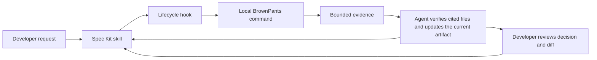

# BrownPants + Spec Kit: a field guide for existing codebases

This guide is for developers who have inherited a system and want a clear path from “what is this code?” to a reviewable, tested change.

## The short version

**Spec Kit organizes the change. BrownPants surveys the code that already exists.** Spec Kit keeps the request, acceptance criteria, plan, and tasks together. BrownPants finds source and project evidence that helps the team write those artifacts accurately and check the finished work.

BrownPants is an assistant to the workflow, not an automatic code judge. Its reports are leads to inspect. The developer and team decide what the system should do, whether a finding applies, and whether the change is ready.

In this repository, **Spec Kit is the spec engine**: `specify` installs and configures it, and `$speckit-*` agent skills run its lifecycle. **SDD** means spec-driven development: agree on expected behavior first, then plan and implement against that agreement. A **feature** is one proposed change and its files under `specs/`.

### The agent loop, in one picture



This is an API-like loop through commands and hooks, not a hosted BrownPants service. Spec Kit tells the agent which phase is running; the hook calls BrownPants; BrownPants returns deterministic Markdown or JSON; the agent checks important evidence in source and continues the phase. Hooks run when the host dispatches a Spec Kit command. They do not run as a background daemon or make decisions between developer requests.

## What BrownPants brings to the job

| When you need to… | Try… | What you get |
|---|---|---|
| Get oriented in an unfamiliar repository | `brownpants inspect . --format markdown --limit 10` | Project and language inventory, supported source evidence, likely tests, and detected Spec Kit/OpenSpec work items. It does not build the repository. |
| Find code related to a bug report | `brownpants investigate . --clue "timeout" --clue "ORD-42"` | Bounded file and line matches for literal clues. These are search leads, not proof of root cause or test coverage. |
| Give an agent a focused evidence handoff | `brownpants evidence . --clue "OrderImportWorkflow" --changed managed/Workflows/OrderImportWorkflow.cs --format json` | A bounded, versioned report joining selected source evidence, changed paths, project context, and analysis limits. Add `--semantic` only for trusted project files. |
| See who may call changed managed code | `brownpants impact . --changed src/OrderService.cs --format markdown` | Resolved C#/VB caller and constructor paths when compiler context loads; native and interop paths remain clearly marked candidates. Managed impact loads MSBuild projects, so imported targets may run. |
| Review a cross-thread WinForms concern | `brownpants winforms analyze .` | Source-located control-write candidates and recognized background/marshaling syntax. A candidate does not prove a runtime thread violation. |
| Make a feature or bug easier to review | `brownpants workbench .` | A local HTML view of the active work item. Add `--engine openspec` for a unique active OpenSpec change. The review page does not edit the spec or send data to a service. |
| Inspect instruction files or make a cited context frame | `brownpants instructions .` and `brownpants frame create ...` | Instruction source locations and section anchors, or a source-linked Markdown frame whose freshness can be checked with `frame validate`. Hosts still decide what context they load. |
| Decide where a proposed team rule belongs | `brownpants placement --rule "..." --scope ... --durability ... --purpose ...` | A deterministic recommendation for constitution, feature spec, or agent guidance. It does not edit those files. |
| Validate or export task-based model preferences | `brownpants models validate .`, `brownpants models report .`, `brownpants models export . --host codex` | Checks the optional `.brownpants/models.json` policy and exports a profile for a selected supported host. It does not launch models or check availability. |
| Draw local diagrams | `brownpants diagram . docs/flows/access-review.md --output TestResults/access-review.png` or `brownpants chart callers . --source <file> --method <symbol> --semantic --output TestResults/callers.png` | Local PNG and editable diagrams.net output for supported flow descriptions and caller charts. See the [flowchart guide](flows/access-review.md). |
| Trace delivery evidence or prepare a review | `brownpants devops trace ...`, `brownpants pr preview ...` | Opt-in links between configured Azure DevOps work and delivery evidence, or a local PR preview. Provider operations that contact a service require explicit online/confirmation options; BrownPants does not approve or merge. |

BrownPants also reports framework and architecture candidates such as WinForms, NHibernate, dependency injection, factories, MFC, COM, and C++/CLI. Check the evidence label and cited source before treating a candidate as a relationship.

The same local context workflow can be invoked from supported agent/IDE adapters: Codex and Claude Code skills, Cursor project commands, and Copilot prompts or skills. These are entry points to BrownPants evidence; they do not give BrownPants access to hidden model context or bypass host/organization policy. See the [agent-skill](../integrations/agent-skills/README.md), [Cursor](../integrations/cursor/README.md), and [Copilot](../integrations/copilot/README.md) guides.

### What language coverage means

The report names the evidence level instead of implying that every listed language is compiler-analyzed:

- C# and Visual Basic use Roslyn syntax analysis by default. Legacy .NET Framework source can be inspected without building it.
- JavaScript and TypeScript have bounded source records and module/call evidence with explicit resolution status.
- Python, Java/Kotlin, Go, and native C/C++ coverage is lexical candidate analysis for the listed patterns.
- Other recognized languages may be inventory-only.

Use the report’s language-coverage and evidence-limit sections to see what was analyzed in your repository. `inspect --semantic` and `evidence --semantic` opt into MSBuild-backed managed calls and constructors; managed `impact` also loads project context. Project evaluation may run imported targets, so use those modes only when the project files are trusted. Default `inspect` does not evaluate MSBuild imports.

## Run BrownPants yourself

Run commands from the repository root you want to inspect. The installed command is `brownpants`. In this checkout, the source form is:

```powershell
dotnet run --project src/BrownPants.Cli -- inspect . --format markdown --limit 10
```

For JSON, which is useful to scripts and agents:

```powershell
dotnet run --project src/BrownPants.Cli -- inspect . --format json --limit 10
```

If the global command is installed, omit the `dotnet run` prefix. If it is not on `PATH`, use the repo-local shim when one is installed:

```powershell
.\.tools\brownpants.exe inspect . --format markdown --limit 10
```

These examples describe the current CLI in this checkout. If an older installed tool says a command is unknown, run it through the source form above or update the tool; do not conclude that the capability is absent from the current project.

Reports go to the terminal by default. Save a report only when you need a file to review or hand to an approved agent:

```powershell
brownpants evidence . --clue "OrderImportWorkflow" --format markdown --limit 20 > TestResults/order-import-evidence.md
```

`TestResults/` is ignored by Git and excluded from normal repository inventory. Reports can still reveal paths, project structure, symbols, and source evidence; review them before sharing. Default inspection is local and read-only. It does not call an AI service, build projects, or modify source files.

## A worked brownfield example

Suppose the request is: **“Retry failed order imports.”** Do not start by guessing which class owns retries. Survey the example repository, then follow evidence to the likely workflow and tests:

```powershell
brownpants inspect examples/brownfield-bug-lab --format markdown --limit 10
brownpants evidence examples/brownfield-bug-lab/managed `
  --clue "OrderImportWorkflow" `
  --changed Workflows/OrderImportWorkflow.cs `
  --format json --limit 20
brownpants impact examples/brownfield-bug-lab `
  --changed managed/Persistence/OrderRepository.cs `
  --format markdown --limit 1000
```

The first report maps the managed and legacy/native project areas. The focused evidence report points to matching source, tests, and project context. Impact follows compiler-resolved managed calls when project context is available and labels native/interop links as candidates. Together these reports help the team ask better questions: where does an import enter, what persists it, what should a retry do after a partial save, and which regression test would prove the intended behavior?

Then write a product decision such as “a failed item may be retried once, and a successful item is not saved twice” into the feature’s acceptance criteria. BrownPants can find the code and callers; it cannot decide that policy or prove the tests cover it.

## A low-token workflow for a huge WinForms/MFC system

Imagine a decades-old desktop application with thousands of forms, MFC command maps, C++/CLI bridges, factory registrations, and data transforms. The goal is to give the agent a small, reviewable slice of evidence, not to paste the repository into a prompt.

### 1. Start with a bounded map

```powershell
brownpants inspect <repo> --format markdown --limit 5
```

BrownPants scans locally and returns counts plus small samples. The local scan can traverse the repository, but the model receives only the report you provide; it does not receive every source file. If the summary is still too large, save it locally and pass only the relevant section or move directly to focused evidence.

`--limit` bounds samples; it is not a total-token limit, and the report still contains summaries for other sections. For a strict context budget, prefer `evidence` with a few distinctive clues and a small result limit over repeatedly injecting the full inventory.

### 2. Search for the user's words and known entry-point clues

Use distinctive names from the issue: an MFC command ID, form/control name, menu caption, factory or transform symbol, table name, log message, or exception text.

```powershell
brownpants evidence <repo> `
  --clue "IDM_IMPORT_ORDERS" `
  --clue "TransformOrders" `
  --format json --limit 10
```

Expected result: a small JSON report with source paths and lines, project/language context, why findings matched, and any omitted count. `--clue` values select matching evidence; they do not prove a relationship. Open the few cited files that matter. Do not ask the model to `cat` every folder or read every class.

### 3. Follow only the selected path across UI and native boundaries

When you identify likely files, add them as changed paths. For managed code, semantic resolution can add caller impact if those project files are trusted. For native paths, BrownPants reports supported MFC dispatch, qualified calls, and C++/CLI links as candidates with source locations.

```powershell
brownpants evidence <repo> `
  --clue "IDM_IMPORT_ORDERS" `
  --changed src/OrderImportView.cpp `
  --changed src/OrderImportWorkflow.cs `
  --format json --limit 10

brownpants winforms analyze <repo> --format markdown --limit 10
brownpants impact <repo> --changed src/OrderImportWorkflow.cs --format markdown --limit 10
```

Expected result: the MFC command/handler and bridge candidates stay separate from compiler-resolved C#/VB callers; WinForms control writes and thread/marshal clues are labeled candidates; the impact report shows bounded callers and completeness limits. Managed impact loads MSBuild projects. If the project imports are not trusted, stay with default inventory and source-local evidence.

If the team needs a picture, make one chart for the selected method rather than a map of the whole system:

```powershell
brownpants chart callers <repo> --source src/OrderImportWorkflow.cs `
  --method "Company.Orders.OrderImportWorkflow.Import" --semantic `
  --output TestResults/order-import-callers.png
brownpants chart flow <repo> --source src/OrderImportWorkflow.cs `
  --method "Company.Orders.OrderImportWorkflow.Import" --semantic `
  --output TestResults/order-import-flow.png
```

Charts are local outputs; callers use compiler-resolved managed calls, while native and interop relationships retain their candidate labels. The selected symbol must match the source declaration. These semantic chart commands can evaluate imported project targets.

### 4. Keep the agent's context on a leash

Tell the agent the budget and the paths it may inspect. Ask it to expand the scope only when the cited evidence leaves a specific question unanswered. For example:

> Keep repository evidence under 4,000 tokens for this pass. Use BrownPants focused evidence for `IDM_IMPORT_ORDERS`, `TransformOrders`, and the two changed paths above. Read only the returned source and test paths, plus the relevant project file. Do not read the whole repository. Return a short path-and-line map, confirmed facts, candidate leads, and unresolved questions. Ask before expanding to more files.

For reusable context, have the agent draft a JSON context frame with a small token budget and source citations, then render and validate it:

```json
{
  "budget": { "unit": "tokens", "requested": 1200 },
  "points": [
    {
      "text": "Use bounded BrownPants evidence to choose source paths; verify important claims in the cited files and keep candidate findings labeled.",
      "sources": [
        { "path": "integrations/speckit/commands/context.md", "anchor": "brownpants-repository-context" }
      ]
    },
    {
      "text": "Run the project’s relevant tests and review generated reports before sharing paths or project structure.",
      "sources": [
        { "path": "AGENTS.md", "anchor": "testing-guidelines" },
        { "path": "AGENTS.md", "anchor": "security--configuration" }
      ]
    }
  ],
  "reviewItems": [
    "Which specific files and tests support the proposed change?",
    "What remains candidate-only or unresolved?"
  ]
}
```

This sample uses paths from the BrownPants repository; replace them with sources that exist in the target repository. A frame contains concise points and links, not copied source contents.

```powershell
brownpants frame create <repo> TestResults/legacy-frame-draft.json TestResults/legacy-frame.md
brownpants frame validate <repo> TestResults/legacy-frame.md
```

The frame validator checks paths, anchors, source digests, and budget overflow; it does not judge whether a summary is true or whether the host loads the frame. Configure the agent to use the frame instead of duplicating the same source files, then review the cited originals. Token estimates are approximate.

### 5. Turn the evidence into a small, testable change

Use Spec Kit to write the desired behavior, not a list of every old subsystem the scan found. Capture only relevant transforms, compatibility rules, and affected tests in the spec and plan. Order tasks around one end-to-end path; include MFC, WinForms, C++/CLI, or factory boundaries only when the evidence shows they participate.

Before editing, verify the acceptance hash and map each task to the spec's AC/SC IDs. During implementation, keep changes limited to those paths and add regression coverage for the behavior being changed. Re-run focused evidence on changed files, then run the project’s documented build/test commands. A BrownPants candidate is not a passing test, and a likely test path is not proof of coverage.

### 6. Prepare the review and follow-up

Use the local workbench to review the feature artifacts and task status. Prepare a local PR preview that lists changed paths, tests, QA instructions, and known evidence gaps:

```powershell
brownpants workbench <repo> --feature specs/NNN-order-import-retry
brownpants pr preview <repo> --feature specs/NNN-order-import-retry `
  --repository team/orders --source feature/order-import-retry --target main `
  --output TestResults/order-import-pr-preview.md
```

After the developer checks the preview, BrownPants can create an explicitly confirmed draft PR with provider-specific `pr create` options. For Azure Boards/Repos, `brownpants devops trace` can connect mapped work items to PR, build, and release references when configured and invoked with `--online`. The developer still commits/pushes code and handles review comments, approvals, merge, and release check-ins in the normal Git/provider workflow. BrownPants does not silently submit, approve, merge, or claim a deployment.

For example, after reviewing the preview, a GitHub draft submission is explicit:

```powershell
brownpants pr create <repo> --provider github `
  --preview TestResults/order-import-pr-preview.md `
  --repository team/orders --source feature/order-import-retry --target main `
  --confirm --online
brownpants devops trace <repo> --feature specs/NNN-order-import-retry --online --format markdown
```

Replace the example repository and branch names with the real ones, and use your organization’s provider configuration. The first command contacts GitHub and creates a draft after confirmation. The trace command contacts Azure DevOps; it requires configured identity and work-item mappings.

The win is less time searching and re-explaining old code, with a traceable handoff from the request to source evidence, criteria, tests, and review. It is not a promise that every legacy relationship is resolved automatically.

## The Spec Kit lifecycle

Spec Kit’s artifacts make the change reviewable from request to evidence. In this repository, the BrownPants extension is configured to refresh context before the main lifecycle commands and after implementation.

| Phase | What the developer/agent does | Typical artifact |
|---|---|---|
| Orient | Inspect BrownPants’ inventory; verify important claims in source, projects, and tests. | No required file; report is in the terminal unless saved. |
| Specify | Agree on users, behavior, edge cases, and measurable acceptance scenarios. | `specs/NNN-short-name/spec.md` |
| Clarify | Resolve genuinely ambiguous product decisions with the team. | Updated `spec.md` |
| Plan | Research repository constraints and choose a design that fits them. | `plan.md`, `research.md`, `data-model.md`, `contracts/`, `quickstart.md` |
| Checklist and tasks | Make review and implementation work concrete and dependency ordered. | `checklists/`, `tasks.md` |
| Analyze | Compare spec, plan, tasks, and BrownPants repository evidence; review mismatches. | Findings for the team to resolve; no automatic product decisions. |
| Implement | Verify the acceptance hash, map tasks to criteria, make the approved change, and run the recorded checks. | Source changes, `acceptance-criteria.sha256`, `acceptance-evidence.json`, verification notes |
| Review and ship | Review code, test results, evidence gaps, and any required manual QA before merging. | Human-reviewed PR and release records |

Common Codex skill commands are `$speckit-specify`, `$speckit-clarify`, `$speckit-plan`, `$speckit-checklist`, `$speckit-tasks`, `$speckit-analyze`, and `$speckit-implement`. Use the commands exposed by your installed Spec Kit/agent version. For a new repository, initialize the integration once; for this already initialized repository, do not run `specify init` again just to start another feature.

For example, ask your installed agent to run `$speckit-specify "Retry failed order imports"`, review the created `specs/NNN-retry-failed-order-imports/spec.md`, then continue one phase at a time with `$speckit-clarify`, `$speckit-plan`, `$speckit-checklist`, `$speckit-tasks`, `$speckit-analyze`, and `$speckit-implement`. Read and review each artifact before moving on; the command names are not approval to skip human decisions.

### What the BrownPants hooks do

The extension registers mandatory `speckit.brownpants.context` refreshes before constitution, specify, clarify, plan, checklist, tasks, analyze, implement, and task-to-issues. It also refreshes after implementation. When the Spec Kit host dispatches those hooks, BrownPants gives the agent a bounded repository map and phase-specific instructions to verify facts against files. It does **not** write the feature for you, select requirements, execute tests, or declare work complete. The bug-evidence hook is optional and runs only when the compatible Spec Kit bug assessment hook is available.

If your agent does not show the commands, verify the installation and refresh/restart that agent:

```powershell
specify extension list
```

From the BrownPants source checkout, replace the placeholder with that checkout’s path to install the local extension into a target project:

```powershell
specify extension add <path-to-brownpants>/integrations/speckit --dev
```

Codex CLI setup uses `specify init --here --integration codex --integration-options="--skills"` in a project that has not yet been initialized. The extension’s [installation guide](../integrations/speckit/README.md) has the full setup and validation steps.

## Copy/paste instructions for your LLM

Use this as a starting prompt, then replace the bracketed request:

> We are changing an existing repository using Spec Kit. Work from the repository root. Let the BrownPants context hook run once for this Spec Kit phase; do not invoke the same context skill again in the same phase. If we are working outside a Spec Kit command, run `$speckit-brownpants-context` manually. Inspect the relevant source, project files, and tests before making claims. Help me specify **[the requested behavior]**. Keep current behavior and acceptance criteria explicit; do not invent architecture or treat candidate signals as confirmed relationships. Follow the installed Spec Kit lifecycle and its BrownPants hooks. Before implementation, verify the feature’s acceptance-criteria hash, map every task to AC/SC IDs in `acceptance-evidence.json`, and stop if an existing acceptance baseline changed without review. Implement only the approved scope. Run the listed build/tests and record observed results and evidence paths; do not mark checks passed unless they ran. Before calling the work ready, review the diff, evidence gaps, and user-facing example. Improve existing capabilities before proposing additional features.

For a manual first pass when working outside a Spec Kit lifecycle command:

```powershell
brownpants inspect . --format markdown --limit 10
brownpants evidence . --clue "<distinctive symbol or error>" --format json --limit 20
```

Paste or attach the report only in an approved environment. If a fact matters to the plan, open the cited source and verify it there.

The repository’s `IDEA-QUEUE.md` is a parking lot, not an active implementation request. Keep new ideas there while improving current capabilities; promote one only after the existing quality bar is met and the team chooses to start it.

## Where files and data go

| Item | Location | How to treat it |
|---|---|---|
| Project principles | `.specify/memory/constitution.md` | Long-lived rules. Change them deliberately; feature requirements belong in the feature spec. |
| Current Spec Kit feature | `specs/NNN-short-name/` | Committed design and review artifacts: `spec.md`, `plan.md`, `tasks.md`, checklists, contracts, and evidence. |
| Active feature pointer | `.specify/feature.json` | Git-ignored, per-checkout convenience state. It is not the Git branch and is not shared in a commit. After switching features or worktrees, check that it points to the feature you intend. |
| BrownPants hook configuration | `.specify/extensions.yml` | Project integration settings. It tells Spec Kit which BrownPants command to dispatch at each lifecycle point. |
| BrownPants report | Terminal output by default | Save intentionally to a reviewed location. Temporary generated reports and workbench files can go under ignored `TestResults/`. |
| Local workbench | `TestResults/brownpants-workbench.html` | Local review page; comments can be exported as a JSON handoff. It does not edit the source feature artifacts. |
| Optional model preference policy | `.brownpants/models.json` | Repository-local preferences for supported agent hosts; it does not choose or launch a model by itself. |
| Custom SDD workflow declaration | `.brownpants/sdd-workflows.json` | Optional declarative paths for an SDD engine BrownPants does not detect automatically. |
| Test/build output | `TestResults/`, `artifacts/`, and build folders | Generated data. These paths are ignored or excluded from normal inventory; inspect them explicitly only when needed. |

BrownPants’ default local commands do not upload repository data. Some advanced delivery commands intentionally contact GitHub, GitLab, Bitbucket, or Azure DevOps only with explicit online/confirmation options. Treat all reports as repository data: paths and code structure may be sensitive, and some findings include short source evidence. Follow your team’s sharing rules.

## Branches and parallel work

The feature directory and Git branch are related by convention, not by the BrownPants context hook. In this checkout the BrownPants Spec Kit extension refreshes evidence; it does not create or switch Git branches. A separately installed Spec Kit Git extension may do that, so check what your project actually installed.

For one feature, start clean and create or switch to the branch your team expects before implementation:

```powershell
git status --short
git switch -c feature/retry-failed-order-imports
```

Then create/select the Spec Kit feature with the installed Spec Kit command. Confirm both independently:

```powershell
git branch --show-current
brownpants inspect . --format markdown --limit 10
```

The second command reports the selected Spec Kit feature when `.specify/feature.json` points to a valid feature directory. That pointer is ignored and can remain stale after a branch switch; do not assume the branch switch updated it. Re-select the feature through your Spec Kit workflow and verify the reported active path before planning or implementing.

For simultaneous features, prefer separate Git worktrees so each checkout has its own ignored active-feature pointer and generated outputs:

```powershell
git worktree add ..\orders-retry -b feature/retry-failed-order-imports
```

Commit and review the actual feature files under `specs/`; do not expect local `.specify/feature.json`, transient reports, or test output to travel with the branch.

## Quality before breadth

Do not promote or implement new features until the existing capabilities are polished to an exemplary standard, covered by relevant tests, honest about their limits, and illustrated with working examples. Keep improving known rough edges instead of treating breadth as the goal. The [feature review checklist](feature-review-checklist.md) helps find the next polish item. A green test run is necessary evidence, not a substitute for a shining example a developer can follow. Ideas in `IDEA-QUEUE.md` remain backlog until that bar is met and the team chooses to start one.

## More detail

- [BrownPants README and complete command examples](../README.md)
- [Spec Kit extension setup and hook contract](../integrations/speckit/README.md)
- [Acceptance criteria and task-evidence workflow](../specs/021-acceptance-criteria-integrity/quickstart.md)
- [Spec Kit workbench quickstart](../specs/035-sdd-workbench/quickstart.md)
- [Repository feature review checklist](feature-review-checklist.md)
